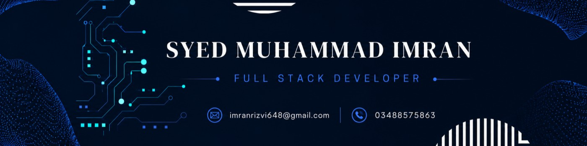
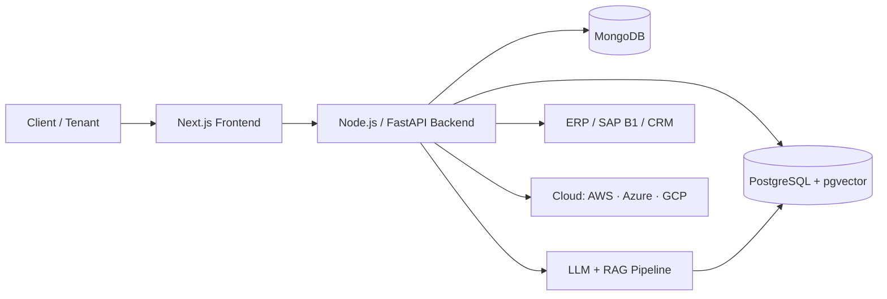

<!-- ============================================================
  GitHub Profile README
  1. Replace USERNAME below with your exact GitHub username
     (find/replace "Syed_Muhammad_Ali_Rizvi15" if that is not it).
  2. Save this file as README.md inside a repo named exactly like your username.
============================================================ -->

<div align="center">



<a href="https://git.io/typing-svg">
  
</a>

<br/>


[](https://github.com/Syed_Muhammad_Ali_Rizvi15?tab=followers)
[](https://github.com/Syed_Muhammad_Ali_Rizvi15?tab=repositories)

[](https://www.linkedin.com/in/syed-muhammad-imran-rizvi)
[](mailto:imranrizvi648@gmail.com)


&nbsp;

&nbsp;

&nbsp;

&nbsp;


</div>

---

## 🚀 About Me

I'm a **Full Stack Engineer based in Karachi, Pakistan**, graduated in Computer Science (Hamdard University, 2025). I build production software end to end: the interface, the API, the database, and the deployment.

Most of my current work sits where **SaaS, AI agents and business systems meet**: multi-tenant platforms, RAG pipelines, ERP and finance automation. I care about clean architecture, security and systems that keep working when real users and real money are involved.

```ts
const me = {
  name: "Syed Muhammad Imran Rizvi",
  role: "Full Stack Engineer",
  location: "Karachi, Pakistan 🇵🇰",
  currentlyAt: "AgenticSense (Nov 2025 - Present)",
  focus: [
    "Multi-Tenant SaaS Architecture",
    "Agentic AI & RAG Pipelines",
    "ERP / CRM / Finance Systems",
    "SAP B1 Integrations",
  ],
  stack: ["Next.js", "TypeScript", "Node.js", "FastAPI", "PostgreSQL", "pgvector", "MongoDB"],
  cloud: ["AWS", "Azure", "Google Cloud", "Oracle Cloud", "Vercel", "Firebase", "Hostinger VPS"],
  openTo: "Interesting problems, SaaS products and long-term collaborations",
} as const;
```

---

## 🏗️ What I've Built

<table>
<tr>
<td width="50%" valign="top">

### 💬 Multi-Tenant AI Chat SaaS
- Multi-tenant platform where each business gets its own isolated workspace
- RAG pipelines over a tenant's own knowledge base
- Agentic AI that can act, not just answer
- Calendly-style appointment booking built into the chat flow

</td>
<td width="50%" valign="top">

### 📄 AI Agentic OCR & Financial Document Platform
- Enterprise platform built for a **Saudi steel manufacturer**
- PDF upload, processing, data extraction and validation workflows
- ERP integration and automated financial workflows
- **Next.js · FastAPI · Python · PostgreSQL**

</td>
</tr>
<tr>
<td width="50%" valign="top">

### 🏭 Enterprise ERP & Corporate Website
- Full ERP built for a **mining and construction company**
- Business dashboards, user management, data management modules
- API-driven architecture plus a professional corporate website
- **Next.js · Node.js · Express.js · MongoDB**

</td>
<td width="50%" valign="top">

### 🧾 Finance Automation (SAP B1)
- **AP Invoice posting** system integrated with SAP Business One
- Cuts manual entry and speeds up the finance workflow
- Validation before posting to keep records clean

</td>
</tr>
<tr>
<td width="50%" valign="top">

### 📈 Sales & CRM Systems
- CRM-style software for managing leads, customers and sales pipelines
- Agentic AI sales assistants for qualifying and following up
- Multi-tenant design so one codebase serves many companies

</td>
<td width="50%" valign="top">

### 🌐 Company Websites
- Fast, SEO-friendly business sites built with Next.js
- Deployed on Vercel with sensible performance defaults

</td>
</tr>
</table>

---

## 🧰 Tech Arsenal

<div align="center">

### ⚡ Languages & Core


### 🖥️ Frontend


### ⚙️ Backend & Frameworks


### 🗄️ Databases


### ☁️ Cloud & Deployment


### 🛠️ Tools


</div>

<details open>
<summary><b>📚 Full breakdown</b></summary>

| Area | What I work with |
|---|---|
| **Stacks** | MERN · PERN · Next.js full-stack |
| **Languages** | TypeScript · JavaScript · Python · PHP |
| **Frontend** | React.js · Next.js · Tailwind CSS · HTML · CSS |
| **Backend** | Node.js · Express.js · FastAPI · REST APIs |
| **AI / Agentic** | Agentic AI systems · RAG pipelines · LLM integration · OCR document intelligence |
| **Databases** | PostgreSQL · **pgvector** · MongoDB (NoSQL) · MySQL |
| **Business Systems** | ERP · CRM · SAP B1 (AP Invoice posting) · Finance automation |
| **Architecture** | Multi-tenant SaaS · scalable API design · secure data handling |
| **Cloud** | AWS · Azure · Google Cloud Platform · Oracle Cloud |
| **Deployment** | Vercel · Firebase · Hostinger VPS · Docker |
| **Tools** | Git · GitHub · Postman |

</details>

---

## 🧠 How I Approach Systems



- **Tenant isolation first.** Data separation is designed in from day one, not bolted on.
- **pgvector for retrieval.** Embeddings live next to relational data, so RAG stays simple and fast to query.
- **Integrate, don't replace.** Business systems like SAP B1 stay the source of truth; I automate around them.
- **Ship, then harden.** Working vertical slices first, then security, monitoring and performance.

---

## 💼 Experience

| Role | Company | Period |
|---|---|---|
| **Full Stack Developer** | AgenticSense | Nov 2025 - Present |
| **Full Stack Developer** | Coderatory | Jun 2025 - Oct 2025 |

---

## 📊 GitHub Stats

<div align="center">


</div>

---

## 🏆 Trophies

<div align="center">

[](https://github.com/ryo-ma/github-profile-trophy)

</div>

---

## 📈 Activity Graph

<div align="center">


</div>

---

## 🤝 Let's Work Together

I'm interested in building **SaaS products, AI agents, ERP/CRM platforms and finance automations**.

<div align="center">

[](https://www.linkedin.com/in/syed-muhammad-imran-rizvi)
[](mailto:imranrizvi648@gmail.com)

*Have an idea that needs a solid system behind it? Message me. I like hard problems.*


</div>
